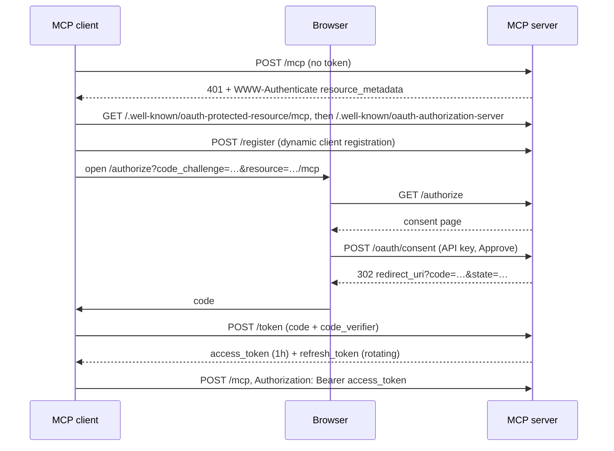
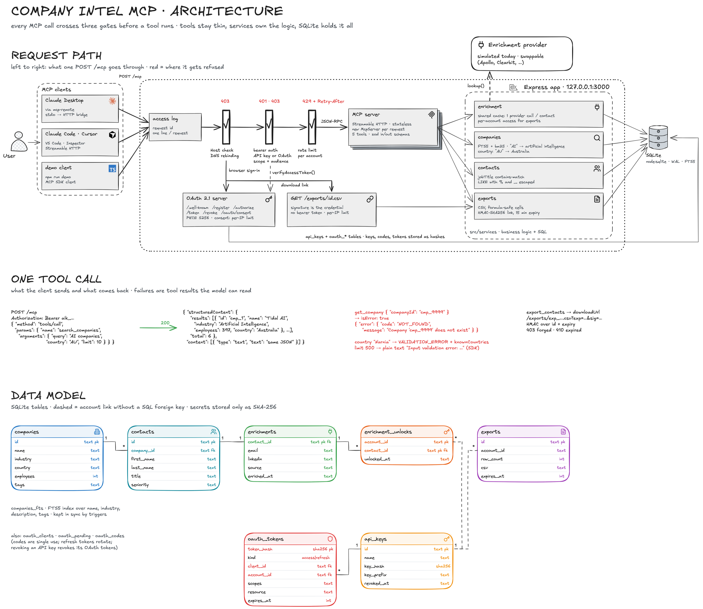
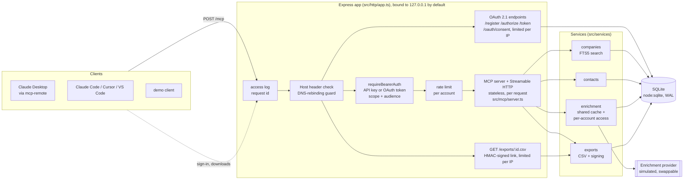

# Company Intelligence MCP Server

An [MCP](https://modelcontextprotocol.io) server that lets AI clients (Claude Desktop, Claude Code, Cursor, VS Code, or any MCP client) search companies, find contacts, enrich them with email and LinkedIn, and export them to CSV.

- **5 tools**: `search_companies`, `get_company`, `search_contacts`, `enrich_contact`, `export_contacts`
- **Two ways to authenticate**: an API key, or OAuth 2.1 with PKCE (browser sign-in, with discovery and dynamic client registration)
- **Streamable HTTP**, stateless: any instance can answer any request
- **SQLite** with full-text search, using Node's built-in `node:sqlite`. No native build, no database server.
- **Seed data**: 60 companies and 337 contacts, generated from a fixed seed so the ids never change

---

## Quick start

Requires **Node.js 22.13 or newer**.

```bash
npm install
cp .env.example .env        # optional; the defaults work for local use
npm run seed                # loads sample data and prints your API key (shown once)
npm run dev                 # http://localhost:3000/mcp
```

In a second terminal, run the scripted client. It walks through every tool and every kind of error:

```bash
MCP_API_KEY=aik_... npm run demo
```

| Command | What it does |
|---|---|
| `npm run dev` | Start with reload on change |
| `npm run build && npm start` | Production build and run |
| `npm run seed` | Reset the sample data. API keys are kept; a first key is created if none exist. |
| `npm run create-key -- <name>` | Create another API key (another account) |
| `npm test` | Unit and end-to-end tests (46) |
| `npm run typecheck` | Type-check everything, including tests and scripts |

`GET /healthz` returns `{ "status": "ok" }` once the database answers. It needs no token, so containers and load balancers can use it as a health check.

---

## Connect an MCP client

Ready-made configs are in [`examples/`](examples). Replace `aik_your_key_here` with the key from `npm run seed`.

**Claude Desktop** (`~/Library/Application Support/Claude/claude_desktop_config.json`). Claude Desktop starts local commands, so [`mcp-remote`](https://www.npmjs.com/package/mcp-remote) bridges it to the HTTP server:

```json
{
  "mcpServers": {
    "company-intel": {
      "command": "npx",
      "args": ["-y", "mcp-remote", "http://localhost:3000/mcp"]
    }
  }
}
```

This uses OAuth: on first use a browser opens the consent page, you paste your API key once, and the client gets its own short-lived tokens from then on. To send the API key directly instead, use the `company-intel-api-key` entry in [`examples/claude_desktop_config.json`](examples/claude_desktop_config.json).

**Claude Code**

```bash
claude mcp add --transport http company-intel http://localhost:3000/mcp \
  --header "Authorization: Bearer aik_your_key_here"
# or leave out --header and run /mcp inside Claude Code to sign in with OAuth
```

**Cursor** (`.cursor/mcp.json`): see [`examples/cursor-mcp.json`](examples/cursor-mcp.json). It reads the key from the `COMPANY_INTEL_API_KEY` environment variable.

**VS Code** (`.vscode/mcp.json`): see [`examples/vscode-mcp.json`](examples/vscode-mcp.json). It prompts for the key and stores it securely.

**MCP Inspector**: `npx @modelcontextprotocol/inspector`. Choose transport *Streamable HTTP*, URL `http://localhost:3000/mcp`, and either set a Bearer token or use the OAuth flow.

---

## Tools

Every tool declares an `inputSchema` and an `outputSchema`. Results come back as `structuredContent` and as JSON text, for clients that only read text. Each tool also carries annotations (`readOnlyHint`, `idempotentHint`, `openWorldHint`) so clients can decide what to confirm with the user first.

### `search_companies`
Free-text search over name, industry, description and tags, ranked by relevance (BM25). Filler words like "companies" are ignored, and common abbreviations are expanded (`AI` also matches "artificial intelligence" and "machine learning").

`country` takes a name in any case or a common short form (`AU`, `US`, `UK`, …). An unknown country is a `VALIDATION_ERROR` that lists the valid ones, rather than a silent empty result.

```jsonc
// input
{ "query": "AI companies", "country": "Australia", "limit": 10 }   // all optional; limit 1-50, default 10
// output
{ "results": [{ "id": "cmp_1", "name": "Tidal AI", "industry": "Artificial Intelligence", "employees": 397, "country": "Australia" }, …],
  "total": 6 }
```

### `get_company`
```jsonc
{ "companyId": "cmp_37" }
// → { "id", "name", "website", "domain", "industry", "employees", "country", "city", "foundedYear", "description", "tags" }
```

### `search_contacts`
`jobTitle` is a case-insensitive "contains" match (`engineer` matches *Senior Software Engineer*). Emails are not returned here; that is what enrichment is for.
```jsonc
{ "companyId": "cmp_37", "jobTitle": "Engineer" }      // both optional; limit 1-100, default 25
// → { "contacts": [{ "id": "cnt_204", "name": "Malinda Cormier", "title": "VP of Engineering", "department", "seniority", "companyId", "companyName" }], "total": 3 }
```

### `enrich_contact`
```jsonc
{ "contactId": "cnt_204" }
// → { "contactId", "email": "malinda.cormier@opalintelligence.example", "linkedin": "https://www.linkedin.com/in/malinda-cormier-305d42",
//     "source": "simulated", "enrichedAt": "...", "cached": false }
```
The result is stored. Calling it again returns the same data with `cached: true`, without another provider lookup. Real enrichment APIs charge per lookup, so this matters. The stored result is shared, so the provider is called only once per contact. Access is tracked per account: a contact's email and LinkedIn appear in an account's exports only after that account has enriched the contact itself.

### `export_contacts`
```jsonc
{ "contactIds": ["cnt_204", "cnt_206"] }                 // 1-500 ids; duplicates are removed
// → { "exportId", "downloadUrl": "http://localhost:3000/exports/exp_….csv?exp=…&sig=…", "expiresAt", "rowCount": 2, "enrichedCount": 1 }
```
The CSV contains contact and company fields, plus email and LinkedIn for contacts this account has enriched. If any id is missing, nothing is exported, and the error lists the missing ids.

### Errors

Tool failures come back as a normal tool result with `isError: true`, so the model can read the error and fix its call. Failures raised by this server are JSON:

```json
{ "error": { "code": "NOT_FOUND", "message": "1 contact(s) do not exist: cnt_99999", "details": { "missing": ["cnt_99999"] } } }
```

| Where it fails | What the client sees |
|---|---|
| Arguments fail the schema (bad id format, `limit: 500`) | `isError: true`, plain text `Input validation error: …`. The SDK checks the zod schema before the tool runs and words this message itself, so it is not JSON. The server `instructions` tell the model about both formats. |
| Unknown company or contact | `isError: true`, code `NOT_FOUND` |
| A value the data does not have (unknown `country`) | `isError: true`, code `VALIDATION_ERROR`, `details` lists the valid values |
| Unexpected bug | `isError: true`, code `INTERNAL_ERROR`, with a generic message. The details go to the log only. |
| No token or a bad token | HTTP `401` with `WWW-Authenticate: Bearer …, resource_metadata="…"` |
| Token without the `mcp` scope | HTTP `403` (`insufficient_scope`) |
| Request addressed to a foreign `Host` | HTTP `403` |
| Rate limit exceeded | HTTP `429` with `Retry-After` |
| Forged, expired or unknown export link | HTTP `403`, `410` or `404` |

---

## Authentication

The `/mcp` endpoint rejects any request without a valid `Authorization: Bearer <token>` header. Two kinds of token are accepted.

**API keys** (`aik_…`): 192 bits of randomness. Only the SHA-256 hash is stored. They can be revoked, and `last_used_at` is recorded. Create them with `npm run create-key`.

**OAuth 2.1 access tokens.** The server is its own authorization server, built on the MCP SDK's OAuth handlers with a SQLite-backed provider ([`src/auth/oauthProvider.ts`](src/auth/oauthProvider.ts)):

- Discovery: `/.well-known/oauth-protected-resource/mcp` (RFC 9728) and `/.well-known/oauth-authorization-server` (RFC 8414). A `401` points clients at the first one.
- Dynamic client registration at `/register` (RFC 7591), so clients need no manual setup.
- Authorization code flow with **PKCE S256 required**. Codes expire after 5 minutes and work once.
- Access tokens last 1 hour. Refresh tokens last 30 days and are **rotated** on every use.
- Tokens are bound to the `/mcp` resource (RFC 8707). Requests for any other resource are refused, and `/mcp` rejects tokens issued for another resource.
- The only scope is `mcp`. Unknown scopes asked for at sign-in are dropped; a token without `mcp` gets `403 insufficient_scope`.
- Codes and tokens are stored hashed. Revocation is at `/revoke`.

To sign in on the consent page, the user pastes their API key. That ties every OAuth token to an account, and **revoking the key also invalidates every token issued through it**.



---

## Architecture



The board above shows the request path, a real tool call with its error cases, and the data model. Edit it by opening [`docs/architecture.excalidraw`](docs/architecture.excalidraw) at [excalidraw.com](https://excalidraw.com) (File → Open). The same request path in text form, which GitHub renders:



**Layers.** HTTP handles transport, auth, rate limiting and logging. The MCP layer holds tool definitions: schemas, descriptions, and turning results and errors into tool results. Services hold the business logic and SQL. Tool handlers are one line each, so the same services could sit behind a REST API unchanged.

```
src/
  index.ts              entrypoint: config, logger, DB, listen, graceful shutdown
  config.ts             env vars, validated with zod; fails fast on bad config
  errors.ts             AppError: expected failures with stable codes
  logger.ts             pino, redacts secrets
  db/database.ts        schema, FTS5 index + triggers, transaction helper
  http/app.ts           routes and middleware
  http/rateLimit.ts     token bucket per account (per IP before auth)
  mcp/server.ts         the 5 tools + error/logging wrapper
  auth/apiKeys.ts       create / verify / revoke API keys
  auth/oauthProvider.ts OAuth 2.1 provider (SQLite-backed)
  auth/consentPage.ts   the sign-in / consent page
  services/             companies, contacts, enrichment, exports
scripts/                seed, seed-data (fixed-seed generator), create-key, demo-client
test/                   unit + end-to-end (real HTTP server, real MCP SDK client)
```

### Design decisions

| Decision | Why |
|---|---|
| **Streamable HTTP, stateless** (a new `McpServer` per request) | With no sessions to pin, it scales horizontally behind any load balancer. Building a server per request costs microseconds. |
| **SQLite via built-in `node:sqlite`** | Nothing to install or run, and no native module to compile. FTS5 gives ranked search without a search service. Moving to Postgres would mean rewriting the services' SQL, not the tools. |
| **Full-text search with BM25 and per-column weights** | `"AI companies"` is natural language, and `LIKE '%AI companies%'` matches nothing. A match on name or industry outranks a passing mention in the description. User text is reduced to plain words, so FTS operators cannot be injected. |
| **Enrichment behind a provider interface, results cached** | The simulated provider is deterministic, so demos and tests are repeatable. A real vendor (Apollo, Clearbit, …) means one new `EnrichmentProvider`. Caching makes calls idempotent and avoids paying twice. |
| **Shared enrichment cache, per-account access** | The provider is paid once per contact, whichever account asks first. Exports join on `enrichment_unlocks`, so one account's enrichment work never leaks into another account's CSV. |
| **Loopback bind and a Host header check** | The MCP transport spec asks local servers to bind to localhost and guard against DNS rebinding. `HOST` opens it up for containers; `PUBLIC_URL`'s hostname is the only other accepted `Host`. |
| **Exports as signed, expiring URLs** | The link must open in a browser or spreadsheet that has no bearer token. An HMAC over `id + expiry`, compared in constant time, makes it unguessable and time-limited without making the download endpoint public. CSV cells are protected against formula injection. |
| **Expected errors returned as tool results, not protocol errors** | The model sees `NOT_FOUND` and can correct itself. Unexpected errors are logged with full detail, but the client only gets a generic message. |
| **OAuth through the SDK's handlers, with a custom provider** | The SDK covers the parts that are easy to get wrong (PKCE check, client authentication, metadata). This code owns the storage and the decision of who gets a token. |
| **Tool descriptions written for the model** | Each says when to use it, what the fields mean, and how it chains to the next tool. Server `instructions` describe the overall flow. |

### Non-functional requirements covered

- **Validation**: zod schemas on every tool input, also used to generate the JSON Schema clients see; environment config is validated at startup.
- **Error handling**: stable error codes, `isError` results, a JSON-RPC-shaped error handler for bad HTTP bodies, graceful shutdown.
- **Logging**: structured pino logs, one line per request (request id, account, JSON-RPC method, status, latency) and one per tool call (tool, outcome, error code, latency). Authorization headers are redacted; export link signatures are never logged.
- **Rate limiting**: a token bucket per account (`RATE_LIMIT_PER_MINUTE`), with `RateLimit-*` and `Retry-After` headers. The consent form and export downloads have no account yet, so they are limited per client IP. The SDK rate-limits its own OAuth endpoints.
- **Type safety**: strict TypeScript with `noUncheckedIndexedAccess`; tool argument types are inferred from the zod schemas.
- **API documentation**: this README, plus self-describing tools (`tools/list` returns schemas, descriptions and annotations).

---

## Configuration

| Variable | Default | |
|---|---|---|
| `PORT` | `3000` | |
| `HOST` | `127.0.0.1` | Interface to bind. Use `0.0.0.0` inside a container. |
| `PUBLIC_URL` | `http://localhost:$PORT` | Base URL clients reach. Used for OAuth metadata and export links. Its hostname is the only non-loopback `Host` header accepted. |
| `DATABASE_PATH` | `data/app.db` | |
| `EXPORT_SIGNING_SECRET` | random per start | Set it, or export links stop working after a restart (the server warns). |
| `EXPORT_TTL_MINUTES` | `15` | |
| `RATE_LIMIT_PER_MINUTE` | `60` | Per account on `/mcp`; per IP on the consent form and export downloads |
| `LOG_LEVEL` | `info` | `trace`, `debug`, `info`, `warn`, `error`, or `silent` |

## Testing

`npm test` runs 46 tests in under a second. The end-to-end tests start the real Express app on a random port with an in-memory database and talk to it through the official MCP SDK client:

- the `401` and its `WWW-Authenticate` header, unknown keys, revoked keys
- tool discovery: names, schemas, annotations
- every tool's success path and its `NOT_FOUND` / validation errors, country short forms and unknown countries
- exports only include enrichment the exporting account did itself
- export download, a tampered link (`403`), an expired link (`410`)
- the rate limit (`429` + `Retry-After`), per account and per IP
- the Host header check (`403` for a foreign host)
- OAuth: metadata, consent page CSP allowing the client's redirect, wrong key on the consent page, deny, wrong PKCE verifier, code replay, refresh token rotation, unknown scopes dropped, tokens for another resource or without the `mcp` scope refused, revoked key cutting off its tokens
- the MCP SDK's own OAuth client running discovery, registration, sign-in and a tool call end to end

## Known limits and next steps

- **Rate-limit buckets live in memory**, so they apply per instance. Move them to Redis when running more than one instance.
- **The enrichment provider is simulated.** Plug in a real vendor through `EnrichmentProvider`, and add a timeout and retries around it.
- **Exports are stored in the database** (fine at ≤500 rows). Larger exports would stream to object storage and return a pre-signed URL.
- **Search returns pages through `limit` + `total`.** Add cursor pagination if the dataset grows.
- **The consent page signs users in with their API key.** In a real product it would hand off to the company's identity provider; the provider code would not change.

All seed data is fictional. Company domains use the reserved `.example` TLD, so none can belong to a real company.
